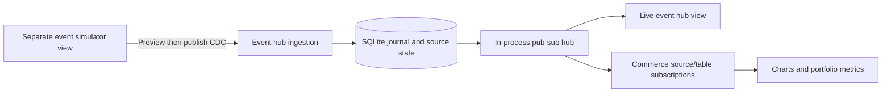

# Prototype assessment and scope

The supplied business pitch and requested scenarios are sufficient for an investor MVP. The application demonstrates a source change → shared event hub → selected subscriber → business graph flow. It demonstrates feasibility and interaction, not customer demand, a production connector or measured conversion lift.

## Implemented scope

| View | Working behavior |
| --- | --- |
| Event hub | All accepted unique CDC changes, newest receipt first; absolute event and receipt timestamps; source system/table/brand/operation filters; paginated complete history; before/after and full-envelope inspection; live updates |
| Event simulator | Choose ERP or e-commerce, supported table, brand, create/update/delete and record data; select current records for update/delete; preview without mutation; explicitly publish to the hub |
| Commerce hub | Independently subscribe to ERP orders, e-commerce orders and e-commerce carts; persist settings; rebuild from retained history; update charts, portfolio, carts and consumed-event feed live |

Workflow automation adds a fourth view: an editable trigger/condition/HTTP/email canvas with saved event subscriptions, anchored interval schedules, variable mapping, execution history and Resend integration. See [workflow scope and setup](WORKFLOWS.md). Resend needs a configured key and verified sender; manual tests capture emails without sending.

These are views of one existing Node application in `srilony/TraBot`, not separate apps or repositories. Separating simulation from observation makes the publisher/hub/subscriber roles explicit.

## Assumptions and metric rules

- Systems and brands are fictional. ERP supports orders; the e-commerce source supports orders and carts. There are no real connections or credentials.
- Default subscription: ERP/orders and e-commerce/carts enabled; e-commerce/orders disabled. Every combination, including no channels, is supported. Settings are shared demo-workspace state, not per-user security permissions.
- Enabling a channel includes retained history immediately. Disabling one removes its current contribution without deleting hub data. It does not create an independent durable broker consumer or offset.
- All amounts are positive integer EUR cents; UTC calendar months are used.
- Monthly **gross order value** is the latest merchandise value, before discounts and excluding tax/shipping, of currently placed orders from subscribed sources. Updates replace values; cancelled or deleted records are excluded. Simulator corrections preserve the original `placedAt` month. It is not cash collected, recognized revenue or a historical accounting ledger.
- **Open-cart opportunity** is the current value of distinct subscribed abandoned carts, excluding explicit converted carts and carts linked to subscribed placed orders. It is a stock across time, never added to order value or presented as guaranteed future revenue.
- **Recovered order value** describes orders linked to previously abandoned carts; it does not establish that a nudge caused a purchase.
- A cart is explicitly set to abandoned by a simulated source change. Real inactivity detection, timing and customer messaging remain unimplemented. The earlier proposed 60-minute rule is a future source-integration decision.
- Same brand/table/record IDs across subscribed sources resolve to the latest event timestamp, then receipt sequence, including tombstones. Source identifiers must be reconciled deliberately in a real integration; this demo assumes shared IDs mean the same record.

## Architecture

One Node 24 process and one SQLite file serve all views. The journal retains accepted changes; per-source current records and saved subscription rules drive commerce projections. Writes commit before notifications. Browser SSE subscribers receive authoritative snapshots, so reconnect/reload recovers current state without reapplying deltas twice. Server processes and connections must restart after cloud environment publication.

Version-one databases migrate once into CDC. Original journal/projection tables are retained, while new logic uses CDC tables. Original order events map to ERP/orders and cart events to e-commerce/carts; these source assignments are inferred and visibly marked `legacy-migration`. They are not historical proof of real system-of-record capture.

## CDC and integrity

Envelopes contain event ID, event timestamp, system/table, brand, operation and before/after images. The hub adds receipt time and sequence. Create has null before; update has both; delete has null after. This is a vendor-neutral CDC-style format, not full Debezium or another connector's wire protocol.

Duplicate deliveries do not create additional accepted rows or inflate totals. Record changes require matching current before images. Invalid/stale changes fail visibly; a rejected request is not an accepted journal entry. The event hub shows the complete accepted history with pagination rather than the commerce feed's short recent list.

Reset is an explicit simulator action that deletes active CDC/source data and restores fictional history. Subscription choices persist. No reset happens on navigation or restart.

## Validation goals

- An ERP order updates the matching month/brand without refresh in multiple windows.
- An unsubscribed e-commerce order still appears in the hub and only affects commerce after that channel is enabled.
- Before/after updates replace values; deletes retract current metrics and retain all journal entries.
- Subscription changes, reload, process restart and legacy migration preserve intended data/state.
- Source carts update independently, with no revenue invented from opportunity or conversion status alone.
- Duplicate/stale changes cannot inflate or corrupt metrics; previews never mutate data.
- Filters, full-history pagination, inspection, mobile layout and visible errors work.

## Deferred business and platform scope

Inventory, fulfillment, service/feedback, finance reconciliation, custom-app builders, production workflow orchestration, live connectors, identity/consent, authentication and multi-currency handling are outside this version. An independent durable broker, retry/dead-letter queues, partitions, consumer checkpoints and multi-process delivery guarantees are also deferred.

The pitch's external market/returns statistics were not independently verified for this implementation and are not used as proof in the app. The proposed differentiation and willingness to pay remain hypotheses. A useful next validation is to show this flow to a portfolio operator, compare it with a real exception they handled, and seek a concrete pilot commitment if it changes their decision.
