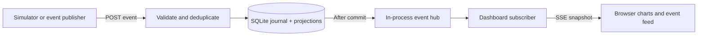

# Prototype assessment and scope

Based on `Builders_Pitch_Sriram.docx` and the accompanying request.

**Assessment: sufficient to build a focused investor demo with explicit assumptions.** The pitch defines the buyer, multi-brand context and event-driven approach; the request supplies two concrete scenarios. It does not define event schemas, metrics, abandonment timing, integrations or demo acceptance criteria. The prototype fills those gaps provisionally and demonstrates feasibility and interaction, not demand or conversion lift.

| Area | Provided | Working prototype decision |
| --- | --- | --- |
| Audience | Portfolio managers and leadership; groups and aggregators | One portfolio, three fictional brands, one shared view |
| Main scenarios | Order events update monthly revenue; unchecked-out carts show potential | Implement both and a separate mock-nudge / simulated-checkout journey |
| Wider vision | Inventory, fulfillment, service, finance, custom apps and workflows | Defer these to keep the first demo small |
| Commerce source | Generic ecommerce publisher | Interactive simulator; no live store or credentials |
| Revenue definition | Monthly gross revenue | Gross merchandise order value before discounts, excluding tax/shipping; booked demand, not cash or recognized revenue |
| Cart abandonment | Unchecked-out cart event | Explicit simulator event; proposed future rule: 60 minutes of inactivity, subject to source capability |
| Potential revenue | Value requiring a nudge | Current unconverted cart value, not a forecast or guaranteed recoverable revenue |
| Nudge | Suggested response to an opportunity | Record a mock action; send no message; checkout is a separate simulation |
| Investor success | MVP demonstration | Live graph update, filtering, event trace and repeatable reset |

## Metrics and data

- All amounts use integer **EUR cents**. All event-month boundaries use **UTC**.
- **Monthly gross order value:** sum of unique placed orders' gross merchandise value before discounts, excluding tax/shipping, by event time. No payment, return or cancellation lifecycle is modeled; this is not net sales or reconciled revenue.
- **Open-cart opportunity:** current value of distinct abandoned carts not linked to a checkout. This is a stock across time, not a monthly flow. Never add it to booked order value.
- **Recovered order value:** orders linked to carts abandoned before checkout. This is descriptive linkage, not evidence that a nudge caused conversion. A cart may check out without a nudge.
- Six-month totals include the current partial month. A complete prior month is not a like-for-like comparison.
- Fictional brands and simulated events remain labeled. Reset deletes events in the active demo database and restores seeded history.

## Bare minimum architecture

1. **One Node 24 process:** event ingestion, transactional projection, in-process pub-sub hub, Server-Sent Events (SSE), simulator and static frontend.
2. **One SQLite file:** accepted event journal plus order/cart projections; persistent across server restarts.
3. **One browser dashboard:** charts, brand filter/comparison, actionable carts, event feed and simulator.

The backend publishes only after storage commits. Browser subscribers receive authoritative snapshots instead of incrementing metrics locally. Reconnect recovers missed changes using the current snapshot. Persisted state survives a process restart; processes and live subscriptions must restart after environment publication.

This demonstrates real pub-sub **within one process**. It is not an Azure Event Hubs or Kafka deployment. An independent durable broker, partitioning, retries, multi-process fan-out, user authentication and production delivery guarantees are deferred.

## Event contract

Envelope: `eventId`, `type`, `occurredAt` (ISO timestamp with timezone), `brandId`, `source`, `payload`.

| Type | Payload | Effect |
| --- | --- | --- |
| `order.placed` | `orderId`, optional `cartId`, `amountCents`, `currency: "EUR"` | Add one order to its month; close linked cart |
| `cart.abandoned` | `cartId`, `amountCents`, `currency: "EUR"` | Add one unconverted cart to opportunity |
| `cart.nudge_requested` | `cartId` | Record mock action; no sale or external send |

Event IDs deduplicate deliveries; reuse with different content conflicts. Stable brand/order and brand/cart IDs also prevent duplicate business counts. A late abandonment cannot reopen a converted cart. Cart-value edits are unsupported in this MVP. Invalid amounts, unknown brands and mixed currencies are rejected.

## Acceptance criteria

- A €100 order changes exactly its brand and month by €100 in two subscribed browser windows, without refresh.
- Re-delivering an event or order cannot inflate the graph.
- A €75 abandoned cart adds €75 opportunity. A mock nudge adds no sales.
- Its separately simulated checkout removes €75 opportunity and adds €75 order value once.
- Late abandonment cannot reopen a converted cart.
- Reconnect/reload restores current state; restart preserves SQLite data.
- Filtering, visible failures, responsive layout and reset work.

## Business evidence and remaining decisions

The pitch's market/returns statistics were not independently verified in this implementation task and are not presented as proof in the app. Custom applications plus shared metrics/workflows are proposed differentiation, not a demonstrated moat. The demo does not validate willingness to pay. A useful next step is to show the flow to a portfolio operator, compare it with a real exception they handled, and seek a concrete pilot commitment if it changes their decision.

The first clarification is simulator versus an existing store. The simulator is the default until specified otherwise. Before a live pilot, agree on provider, metric definitions, payment/returns lifecycle, abandonment threshold, currency policy, customer identity/consent for nudges, hosting and access control. Those decisions do not block this fictional-data demo.
